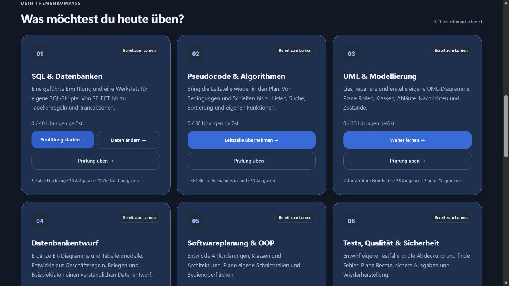
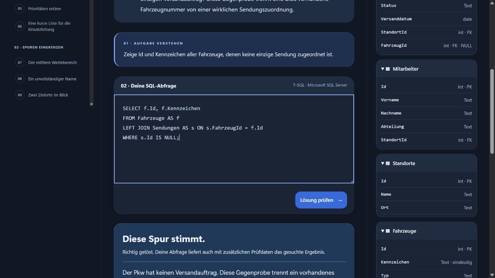
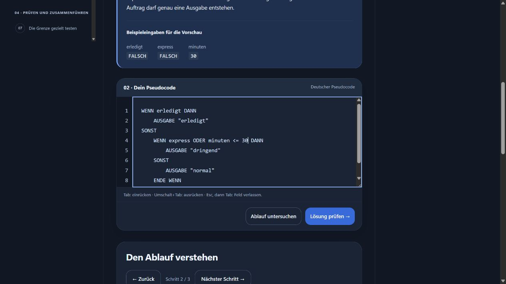
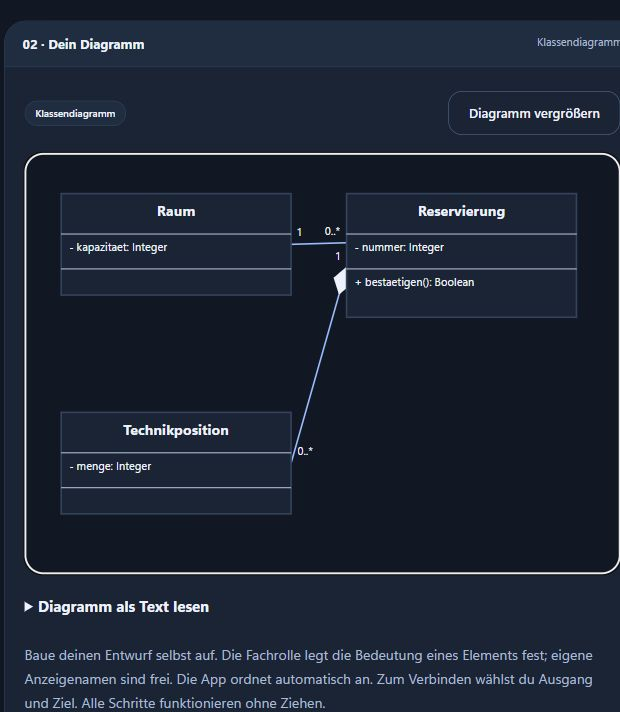
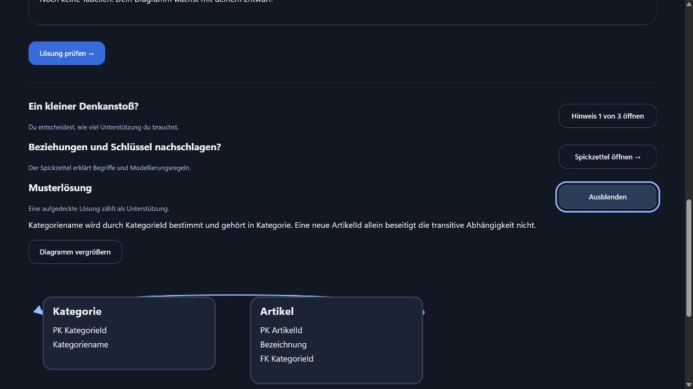
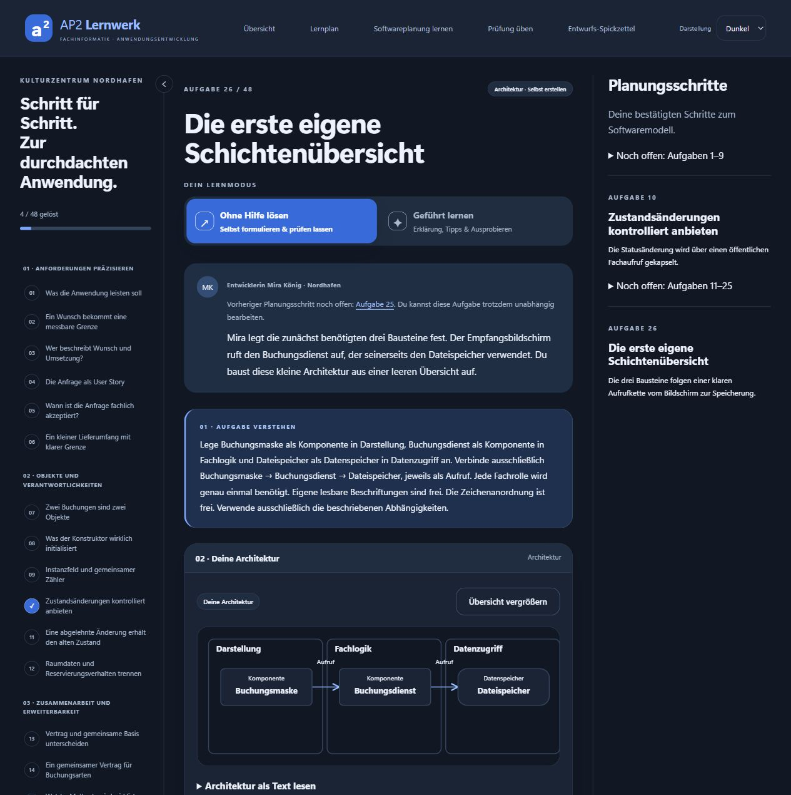
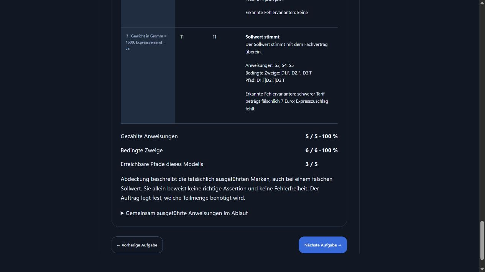
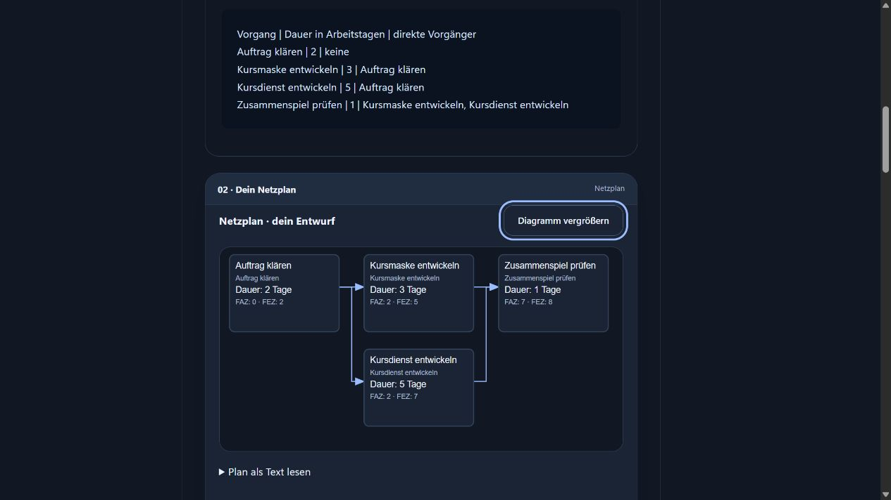
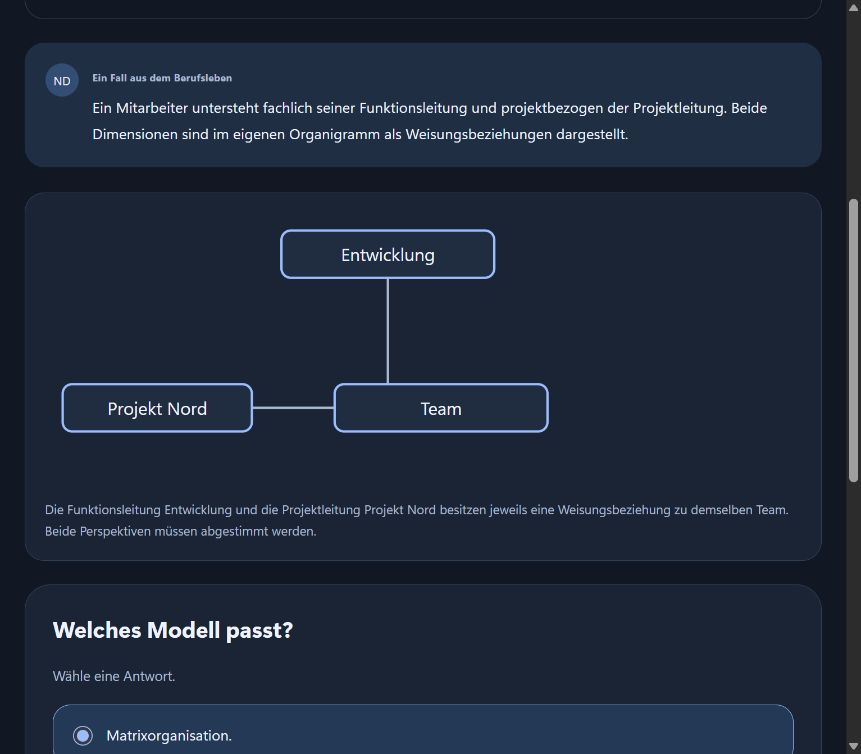

# AP2 Lernwerk

**Selbst lösen. Zusammenhänge verstehen. Sicherer in die AP2 gehen.**

Ermittle mit SQL, entwickle eigene Algorithmen und UML-Diagramme, entwirf relationale Datenmodelle, plane Software, entwickle eigene Testsätze, plane Projekte und festige dein WiSo-Wissen – mit verständlichen Erklärungen, freiwilligen Hilfen und gespeichertem Lernfortschritt.

**[Windows-Version herunterladen →](https://github.com/b0rnkilla/FIAE-AP2-Lernwerk/releases)** · Deutsch · Lokal im Browser

## Dein Lernraum für die Prüfung

**454 Lernübungen in acht Lernbereichen** – dazu eigene Prüfungsrunden.

Der Quellstand für die erste Beta trägt die Version **1.0.0-beta.1**. Den veröffentlichten Windows-Stand findest du unter **Releases**.

<table>
  <thead><tr>
    <th width="25%">SQL &amp; Datenbanken</th>
    <th width="25%">Pseudocode &amp; Algorithmen</th>
    <th width="25%">UML &amp; Modellierung</th>
    <th width="25%">Datenbankentwurf</th>
  </tr></thead>
  <tbody>
    <tr valign="top">
      <td>Löse einen Fall mit eigenen Abfragen. Übe JOINs, Gruppierungen und Datenänderungen.</td>
      <td>Schreibe eigene Abläufe, finde Fehler und untersuche deine Lösung Schritt für Schritt.</td>
      <td>Lies, repariere und erstelle eigene Diagramme in fünf UML-Notationen.</td>
      <td>Ergänze ER-Diagramme und Tabellenmodelle. Entwirf aus Unterlagen normalisierte Tabellen.</td>
    </tr>
    <tr>
      <td>40 Lern- und 15 Prüfungsaufgaben</td>
      <td>30 Lern- und zehn Prüfungsaufgaben</td>
      <td>36 Lernaufgaben · drei Prüfungsfälle</td>
      <td>42 Lernaufgaben · drei Prüfungsfälle</td>
    </tr>
    <tr align="center">
      <td></td>
      <td></td>
      <td></td>
      <td></td>
    </tr>
  </tbody>
</table>

<table>
  <thead><tr>
    <th width="25%">Softwareplanung &amp; OOP</th>
    <th width="25%">Tests, Qualität &amp; Sicherheit</th>
    <th width="25%">Projekte &amp; Wirtschaftlichkeit</th>
    <th width="25%">Wirtschafts- &amp; Sozialkunde</th>
  </tr></thead>
  <tbody>
    <tr valign="top">
      <td>Plane Anforderungen, Klassen und Architekturen. Entwirf API-Nachrichten und Formularprototypen.</td>
      <td>Entwickle eigene Testfälle, prüfe Abdeckung und Fehler. Plane Rechte und Wiederherstellung.</td>
      <td>Baue eigene Struktur-, Netz- und Terminpläne. Vergleiche Kosten, Nutzen und Risiken.</td>
      <td>Lerne nach Themen, wiederhole Unsicherheiten und übe berufliche Situationen.</td>
    </tr>
    <tr>
      <td>48 Lernaufgaben · drei Prüfungsfälle</td>
      <td>54 Lernaufgaben · drei Prüfungsfälle</td>
      <td>54 Lernaufgaben · drei Prüfungsfälle</td>
      <td>150 Aufgaben · acht Themen</td>
    </tr>
    <tr align="center">
      <td></td>
      <td></td>
      <td></td>
      <td></td>
    </tr>
  </tbody>
</table>

*Für eine große Ansicht auf das jeweilige Bild klicken.* Eigene Übungsaufgaben, kein offizielles IHK-Angebot. Alle acht Themenbereiche sind nutzbar; eine vollständige Prüfungsabdeckung wird nicht behauptet.

## In drei Schritten starten

1. Unter **[Releases](https://github.com/b0rnkilla/FIAE-AP2-Lernwerk/releases)** das Paket **AP2-Lernwerk-…-win-x64.zip** herunterladen.
2. Das vollständige ZIP entpacken.
3. **AP2-Lernwerk.exe** starten und im Browser loslernen. Läuft das Lernwerk bereits, öffne **http://localhost:5080** im Browser.

Du brauchst Windows x64 und einen aktuellen Browser. Die .NET-Laufzeit ist enthalten. Für SQL ist zusätzlich [Microsoft SQL Server](https://www.microsoft.com/de-de/sql-server/sql-server-downloads) nötig; Pseudocode, UML, Datenbankentwurf, Softwareplanung, Tests/Qualität/Sicherheit, Projekte/Wirtschaftlichkeit und WiSo funktionieren ohne SQL Server. Die automatisch angebotenen Source-code-Archive sind nicht die fertige Anwendung.

Über **Prüfung üben** öffnest du zuerst die Prüfungsinfos. Die Zeit beginnt erst mit **Prüfung starten**. Dein Lernstand bleibt lokal gespeichert. Die beiliegende **ANLEITUNG.md** erklärt Einrichtung und Updates.

**Auch am Handy lernen:** Über **Heimnetz** in der Fußzeile gibst du die laufende App für dein privates Netzwerk frei. Die Seite zeigt Adresse und QR-Code; Windows fragt bei Bedarf nach der Firewall-Freigabe. Alle verbundenen Geräte teilen denselben Lernstand.

## Hilft dir das Lernwerk?

**[☆ Auf GitHub unterstützen](https://github.com/b0rnkilla/FIAE-AP2-Lernwerk)** · **[☕ Einen Kaffee spendieren](https://www.paypal.com/paypalme/b0rnkillafpv)** · **[Fehler oder Vorschlag melden](https://github.com/b0rnkilla/FIAE-AP2-Lernwerk/issues)**

Ein Projekt von **Christopher Weismantel · b0rnkilla**. Über einen Stern auf GitHub, Feedback oder eine freiwillige Unterstützung freue ich mich.

Ausschließlich zur privaten, nichtkommerziellen Nutzung gemäß **[LICENSE](LICENSE)**.

[Projekt & Dokumentation](docs/projektsteckbrief.md) · [Entwicklung](docs/entwicklung.md) · [Prüfnachweise](docs/testprotokoll.md)
